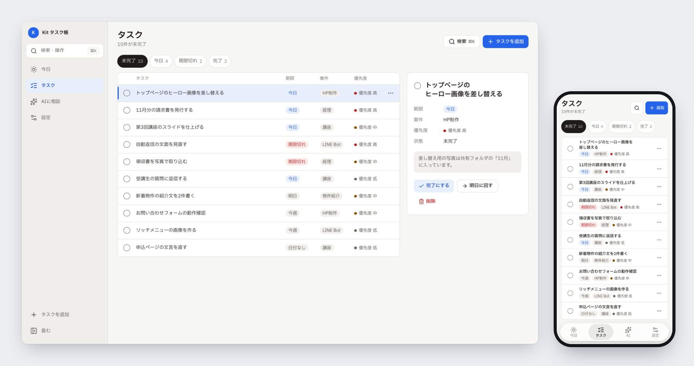
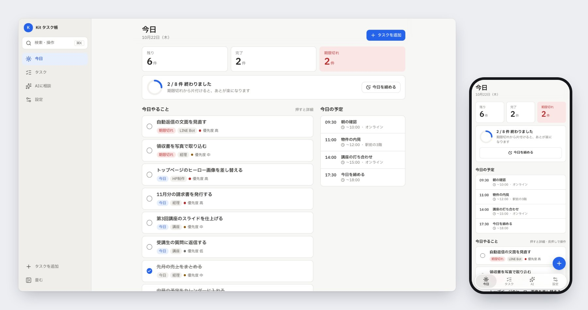
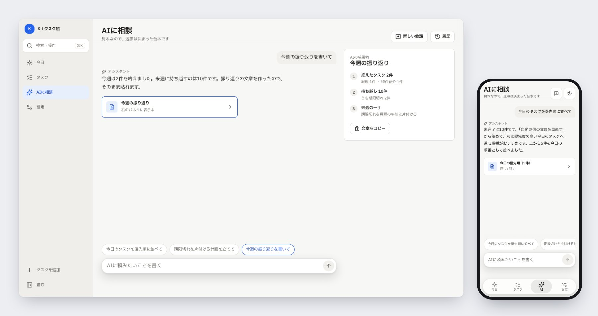
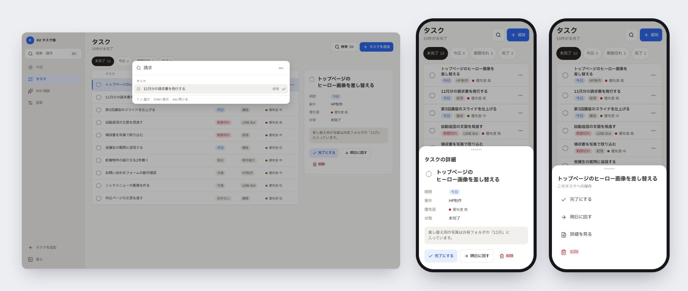
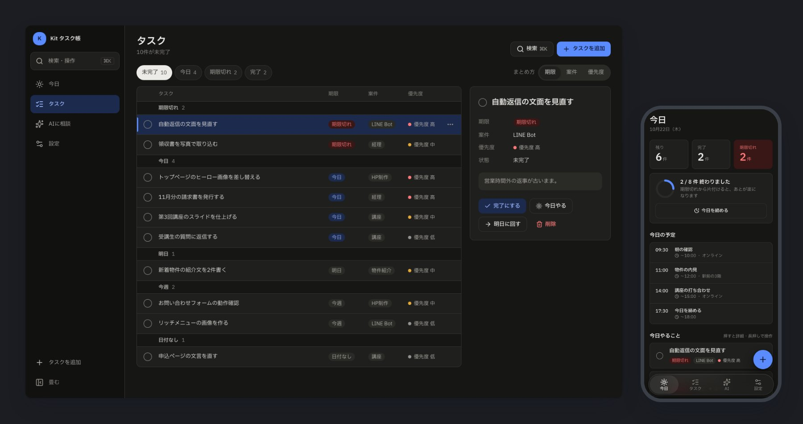
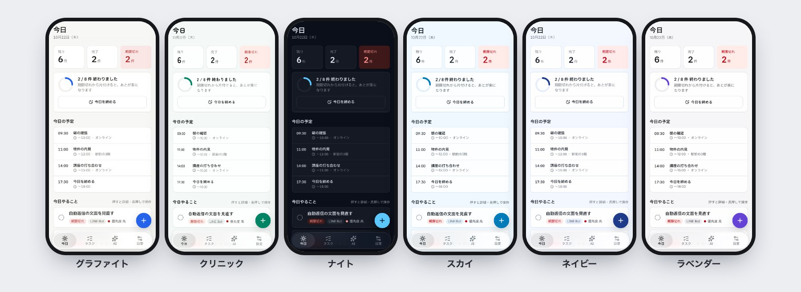
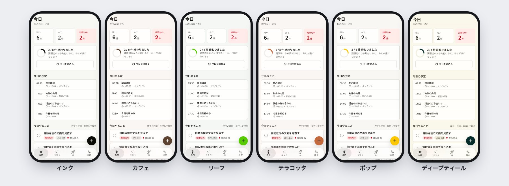

# Workspace Kit

業務ツールの画面を、PC でもスマホでも整った UI/UX にする土台一式。
入れると、ナビ（スマホ＝下タブ／タブレット＝アイコン列／PC＝サイドバー）・ボタン・下から出るシート・お知らせと取り消し・⌘K パレット・色・文字・動きがそろう。

- 見本：https://workspace-kit.vercel.app/kit （テーマ12種と画面の型を切り替えて、スマホ幅と PC 幅を並べて見られる）
- 見本のアプリ：https://workspace-kit.vercel.app （タスク管理。スマホでも開ける）



## 誰のための物か
| こんな人 | できること |
|---|---|
| これから業務ツールを一から作る人 | 見本と同じ土台のアプリが手元で立ち上がる（目安15分）。あとは画面の中身を日本語で頼んで足していく |
| もう動いているツールを磨きたい人 | 今の機能はそのままに、ナビ・色・文字・ボタンを差し替えて、PC でもスマホでも使える画面にする |

## 使い方
### 0. 準備（最初の1回だけ）
1. Claude Code が使えること（ターミナルで `claude` と打って起動できる状態）
2. Node.js 20 以上（ターミナルで `node -v` と打って確かめる。無ければ https://nodejs.org の LTS 版を入れる）
3. pnpm（部品を取り寄せる道具）をターミナルで使えるようにする（権限のエラーが出たら `npm i -g pnpm`）：
```bash
corepack enable pnpm
```
4. Claude Code の中で次の2行を1行ずつ打って、プラグイン（Claude Code に足す追加機能）を入れる：
```
/plugin marketplace add Icchaso/workspace-kit
```
```
/plugin install workspace-kit@workspace-kit
```
※ いまはこのリポジトリが非公開なので、プラグインを入れられるのは招待された GitHub アカウントだけです。

### 1. 一から作る
新しいアプリを置きたいフォルダで Claude Code を開いて、こう頼みます：
```
Workspace Kit で新しくツールを作りたい
```
1. Claude が1回だけまとめて聞きます：アプリの名前・画面（ナビの項目）・画面の型（A 指令室／B 現場／C AI相棒）・テーマ・置き場所。決まっていなければ「おまかせ」で大丈夫です
2. Claude が自動でやります：
   1. アプリを作って部品一式を入れる（初回は取り寄せに1〜2分）
   2. 名前・ナビ・テーマを差し替える
   3. 6つの幅 × ライト/ダークで検査して全部合格にする
3. スマホと PC の画像が届き、`http://127.0.0.1:3000` で開ける状態になります。画面を開いて触ってください
4. あとは「受注の一覧画面を足して」のように日本語で頼めば、同じ作法で画面が増えていきます

### 2. 今のツールを磨く
磨きたいツールのフォルダで Claude Code を開いて、こう頼みます：
```
今のツールを Workspace Kit で整えて
```
1. **偵察（読むだけ）**：使っている技術・今のナビ・色の書き方・画面の一覧を読み、入れる前の画像を撮ります
2. **計画を見せる**：変えること・見た目がどう変わるか・戻し方を1枚の表で見せます。**承認するまで何も変えません**
3. **別のブランチ（本番と分けた作業場所）で入れる**：色と文字 → ナビ → ボタンなどの部品の順に、画面ごとに進めます
4. **確かめる**：
   - ログイン・一覧・保存など今までの操作を実際に押して確かめる
   - 検査を流す
   - 入れる前と後の画像（スマホ 375px と PC 1280px）を並べて見せる

本番に出すかどうかは、画像を見てあなたが決めます。
- Next.js（App Router）＋Tailwind CSS v4 のツール：全部入ります。Pages Router（Next.js の古い作り方）は骨格に少し直しを入れて入れます
- Tailwind CSS v3 や Vite のツール：色と部品だけの軽い入れ方になります（詳しくは [SKILL.md の「対応している環境」](plugin/skills/workspace-kit/SKILL.md)）

### 3. そのほかの頼み方
| 頼み方 | すること |
|---|---|
| 「テーマをラベンダーにして」 | 12種から変える。ブランド色1色だけ変えることもできる |
| 「動きと手触りを仕上げて」 | 動きを8つの観点（目的と頻度・曲線と時間・起点・割り込み・性能・アクセシビリティ・統一感・足りない動き）で監査し、決まった順に直して、合格の条件を全部満たすまで確かめる |
| 「スマホで崩れてないか見て」 | 6つの幅 × ライト/ダークで撮影し、はみ出し・押せる大きさ・文字の小ささ・コントラスト・動きを数字で確かめて日本語で報告する |
| 「Workspace Kit を更新して」 | 入れた版と最新の差分を見せてから当てる |

検査に合格しても、iPhone での手触り（下タブ・シート・キーボード）は実機で一度触って確かめてください。

### Claude Code を使わずに部品だけ入れる（エンジニア向け）
shadcn CLI で入れられます。版を固定した URL を使います（後で同じ命令を流しても同じ中身が入る）。
```bash
pnpm dlx shadcn@4.21.3 add https://workspace-kit.vercel.app/r/v0.4.1/workspace-kit-shell.json
```
| 名前 | 中身 |
|---|---|
| `workspace-kit-css` | トークン＋テーマ12種＋土台と骨格の CSS（`app/workspace-kit.css`） |
| `workspace-kit-ui` | 部品（`components/kit/`）。css も一緒に入る |
| `workspace-kit-shell` | 骨格（`components/shell/`）。ui と css も一緒に入る。アプリごとに書くのは `config/nav.ts` と `config/shell.tsx` だけ |
| `workspace-kit-starter` | 上の全部＋見本のタスク管理アプリ |

手順の中身（Claude が従っている手順書）は [plugin/skills/workspace-kit/](plugin/skills/workspace-kit/SKILL.md) にあります。

## どんな見た目か
落ち着いた業務ツールの見た目です。主役は中身（一覧・数字・文章）で、色は「押せる物」と「状態（期限切れなど）」にだけ使います。
下の画像はすべて見本のタスク管理アプリを、そのまま撮ったものです（左が PC 1440px、右がスマホ 390px）。

### 画面の幅で、ナビの形だけが変わる
| 画面の幅 | ナビの形 |
|---|---|
| 1280px 以上（PC） | 左のサイドバー（畳める） |
| 768〜1279px（タブレット・PC の画面を半分にした時） | アイコンだけの細い列 |
| 767px 以下（スマホ） | 下に浮いたタブ（5つまで。6つ以上は先頭4つ＋「もっと」） |

項目と並び順はどの幅でも同じなので、PC で覚えた場所がスマホでもそのまま使えます。

### 画面の型は3つ（混ぜて使える）
**A 指令室**：一覧＋詳細。PC は表と右の詳細パネル、スマホは1行1枚のカードになり、押すと下から詳細が出ます（上の画像）。

**B 現場**：大きな数字のカード・今日の予定・右下の主ボタン。片手で操作する人向け。


**C AI相棒**：会話と成果物。PC は成果物が右のパネルに出て、スマホは成果物のカードを押すと下からシートで開きます。


### 操作の作法
⌘K（Ctrl+K）で、どの画面からでも探す・移動する・操作するができます。スマホでは詳細や操作が下から出るシートになり、つまみを下に引くと閉じます。


- 戻せる操作（完了・明日に回す・削除）は確認を挟まず、お知らせの「取り消す」で戻せます。確認の画面を出すのは、戻せない操作（外への送信・お金・本番データの削除）だけ、という作法です
- 待ちのあるボタンは、押した瞬間に「◯◯しています」に変わり、二度押しを受け付けません
- 押せる物の大きさは、画面の幅ではなく「指かマウスか」で変わります（マウス 36px／指 44px）

### ダーク表示
すべての色はライトとダークの両方を持っています。端末の設定に合わせるか、⌘K と設定画面で切り替えます。


### テーマ12種
色・字体・角丸の組み合わせを12種から選べます（自分のブランド色1色だけ差し替えることもできる）。どのテーマも文字と背景の明るさの差（コントラスト比）が 4.5:1 以上になるよう自動で確かめています。ナイトはダーク専用です。



### 細かい決まり
- 文字：本文 15px、入力欄 16px（iPhone で入力欄を押した時の自動の拡大を防ぐ）。12px より小さい文字は使わない
- 上下のバーだけ半透明でぼかし、本文は不透明（iOS 26 の Liquid Glass と同じ役割分担）。端末の「透明度を下げる」「視差効果を減らす（動きを減らす）」に従う
- 下タブの選択の板は約 0.18 秒で次のタブへ滑る。行き過ぎて揺れる動きは使わない
- 色は直接書かず、名前の付いた色（トークン。`bg-surface`・`text-fg-2`・`bg-accent` など）を通す。テーマを変えると全部の画面が一緒に変わる

画像は検査台本と同じ見本アプリから撮っています。実物は https://workspace-kit.vercel.app （スマホでも開けます）。

## このリポジトリの中身
| 場所 | 中身 |
|---|---|
| `apps/starter/` | 雛形（見本のタスク管理アプリ）と見本サイト（`/kit`）。配る部品の正本 |
| `packages/tokens/` | トークン（色・文字・余白・角丸・影・動き・押せる大きさ）と土台の CSS |
| `packages/themes/` | テーマ変換（awesome-design-skills の67種 → 日本語の字体の組み合わせ＋コントラスト調整）。`pnpm --filter @workspace-kit/themes build` |
| `registry/templates/` | 後付け用の `config/` の最小の見本 |
| `scripts/build-registry.mjs` | 配る部品（`apps/starter/public/r/*.json`）とプラグインの写しを作る。雛形のビルドのたびに自動で動く |
| `scripts/check-ui.mjs` | 画面の検査台本（6つの幅 × ライト/ダーク。はみ出し・ナビ・文字・押せる大きさ・コントラスト・動き） |
| `plugin/` | Claude Code プラグイン（スキル `workspace-kit`） |
| `設計書/判断記録/` | 決めたことと理由 |

## 作業の命令
```bash
pnpm install
pnpm dev                      # 雛形を開発用に起動
pnpm build                    # 全部ビルド（配る部品も作り直す）
pnpm check:ui http://127.0.0.1:3456 screenshots/check   # next start で起動してから検査
```

## ライセンス
未定（決まり次第ここに書く）。第三者の著作物は [THIRD_PARTY_NOTICES.md](THIRD_PARTY_NOTICES.md)。
